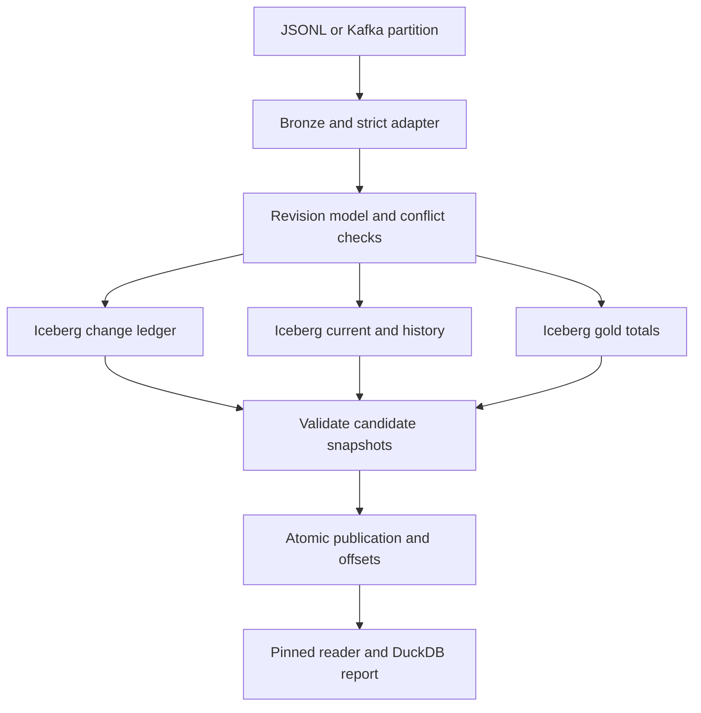

# Retail CDC Lakehouse

**A recoverable CDC lakehouse with Apache Iceberg, revision history and consistent multi-table reads.**

[Español](README.es.md) · [Step-by-step guide](docs/GUIA_COMPLETA.md) ·
[Architecture](docs/ARCHITECTURE.md) · [Validation evidence](docs/VALIDATION.md) ·
[Runbook](docs/RUNBOOK.md)

When an order changes, its current state, history and analytical totals must agree.
If a process exits after writing two of four tables, exposing the latest snapshot of
each table can mix incompatible results. This project solves that problem with a
publication manifest: readers pin all four snapshot IDs from one committed generation.

The workload includes updates, deletes, Kafka tombstones, duplicate delivery, late
logical revisions and a nullable schema addition. Data is **entirely synthetic**;
the demo needs neither credentials nor a public dataset download.

## What is implemented

| Capability | Implementation |
| --- | --- |
| Transport ingestion | JSONL exports or bounded reads from a real Kafka partition |
| Contract | Schema-less Debezium PostgreSQL order envelopes; strict business row validation |
| Bronze | SHA-256 addressed input batches, flushed before processing |
| Lakehouse | Four real Iceberg tables and Parquet files through PyIceberg |
| CDC materialization | Revision-ordered current state, delete markers and revision history |
| Evolution | Add nullable `region` using Iceberg schema evolution |
| Publication | SQLite transaction commits a generation, four snapshot IDs and next offsets |
| Recovery | Retry from the last published change ledger; abandoned snapshots stay invisible |
| Serving | DuckDB aggregates on Arrow tables loaded from pinned Iceberg snapshots |
| Quality | Candidate read-back, replay conflict detection, revision-gap diagnostics and reconciliation |
| Engineering | Locked dependencies, behavioral tests, process-exit drill, CI, wheel and non-root image |

## Quick start

Requirements: Linux or macOS with Python 3.12 and [uv](https://docs.astral.sh/uv/).
Windows users can run the POSIX implementation through WSL2. Docker is optional for
the local demo and required for the documented Kafka Compose setup.

```bash
uv sync --frozen --extra dev
uv run --frozen retail --root data/demo demo --count 1000
uv run --frozen retail --root data/demo report --generation 1
make lint test
```

Use a fresh `--root` for each `demo`; existing data is deliberately not deleted.
Expected final counts:

| Metric | Result |
| --- | ---: |
| Initial fictional orders | 1,000 |
| Transport events including tombstones | 2,467 |
| Current orders after 200 deletions | 800 |
| Historical revisions including delete markers | 2,267 |
| Gold groups | 4 |
| Reconciliation differences / final revision gaps | 0 / 0 |
| PEN amount / USD amount, separately | 3,800,000 / 3,800,000 minor units |

The demo injects a failure after the current-table commit, recovers, replays the last
batch without adding events, and checks that generation 1 remains unchanged. The
test suite additionally exits a subprocess with `os._exit(77)` between commits.
These are correctness drills, not performance benchmarks or power-loss certification.

## Architecture



The publication transaction is an application protocol. Iceberg still commits each
table independently. Direct reads of each table's latest snapshot bypass this protocol
and can observe incomplete work. See [ADR 001](docs/adr/001-publication-protocol.md).

## Run ingestion manually

```bash
uv run --frozen retail generate --output data/input --count 1000
uv run --frozen retail --root data/manual ingest data/input/batch-01.jsonl
uv run --frozen retail --root data/manual ingest data/input/batch-02.jsonl
uv run --frozen retail --root data/manual report
uv run --frozen retail --root data/manual ingest data/input/batch-03.jsonl
uv run --frozen retail --root data/manual report
```

After batch 2, 267 revision gaps are visible. Batch 3 fills them without replacing the
newer current states. `updated_at` is an audit attribute; revision numbers define
history intervals. This is **revision history**, not bitemporal business-time modeling.

## Real Kafka drill

```bash
docker compose up -d --wait kafka
uv run --frozen python scripts/kafka_smoke.py
docker compose stop kafka
```

The drill creates a unique topic, sends 2,467 synthetic Debezium-shaped envelopes,
ingests in batches of 400, checks known totals and sends a contract-breaking record.
That record must fail without advancing the publication or cursor. Topics are retained
for inspection; this script does not delete broker data. Use a fresh `SMOKE_ROOT`
environment variable on subsequent runs.

For a provisioned source topic:

```bash
export KAFKA_BOOTSTRAP_SERVERS=localhost:29092
uv run --frozen retail --root data/source kafka --topic retail.public.orders --partition 0 --limit 1000
```

There is no consumer-group offset dependency. The manifest's `next_offsets` are the
authority. The reader explicitly assigns one partition and fails if the required
offset has fallen below the low watermark. Run partition jobs sequentially on one
root. Source-system Debezium provisioning is an [integration blueprint](docs/SOURCE_INTEGRATION.md),
not an end-to-end PostgreSQL connector certification.

## Repository map

```text
src/retail/       contract, deterministic model, Iceberg storage, engine, query, Kafka, CLI
tests/           contract, CDC, failure, process recovery and transport behavior
scripts/         real Kafka drill and non-destructive Git hygiene checker
docs/            architecture, contracts, guide, operations, validation and ADRs
examples/        tiny fictional input batch
evidence/        small aggregated validation results, no warehouse files
.github/         CI and contribution templates
```

## Scope and scaling

This is a **bounded, single-writer reference engine**: local SQLite catalog/control,
POSIX file locking and complete table rewrites, capped at 100,000 retained transport
records and 32 MiB per batch. It is intended to make correctness mechanisms executable
and reviewable on a laptop. It is not a distributed compute deployment, an HA catalog,
an automatic streaming service or an end-to-end exactly-once guarantee.

The modular boundaries support a documented migration to a REST catalog, object
storage, distributed incremental processing and a transactional publication service;
those changes require implementation and new failure tests. See the
[scaling plan](docs/SCALING.md) and [roadmap](docs/ROADMAP.md).

Logical deletes remove current rows but retain history and Bronze. Snapshot expiration,
orphan cleanup and physical erasure are deliberately not automated because historical
publications pin old snapshots. Never expire them without a retention design.

## For reviewers

Start with [the interview walkthrough](docs/PORTFOLIO.md), then inspect
`engine.py`, `storage.py`, and `tests/test_process_recovery.py`. Validation status,
including what was and was not executed, is recorded in [VALIDATION](docs/VALIDATION.md).
CI is defined but a remote Actions success is only claimed after a real repository run.

Contributions: [CONTRIBUTING](CONTRIBUTING.md). Security: [SECURITY](SECURITY.md).
License: [MIT](LICENSE).
